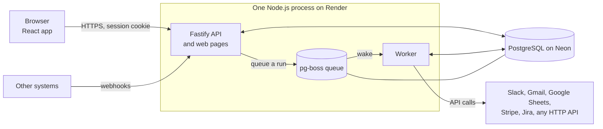
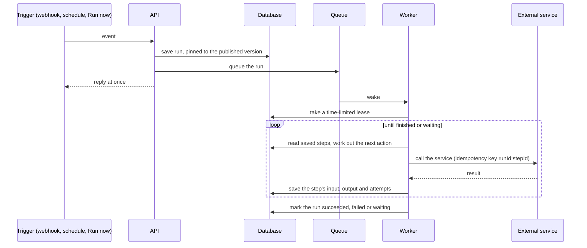

# FlowBridge architecture

The reasons behind each choice are in [DECISIONS.md](DECISIONS.md). The research that led to them is in [research/](research/).

## Overview



| Part | Technology | Job |
|------|------------|-----|
| Interface | React, Vite, React Flow | Every screen, including the workflow canvas. Built to static files that the server sends. |
| API | Node.js, Fastify, Zod | Sign-in, permissions, workflows, runs, connections, webhooks. Validates everything that comes in. |
| Worker | The same Node.js process | Runs workflows step by step, fires schedules and polls, resumes waits, sends notifications, clears old data. |
| Queue | pg-boss | Holds runs waiting for a worker, inside PostgreSQL. |
| Database | PostgreSQL on Neon, Drizzle | The only data store: workflows, runs, credentials, the queue, activity. |

One process runs the API and the worker, because the free host runs one service. Setting `RUN_MODE` to `api` or `worker` runs them separately, with no code change.

## How a run works



1. A trigger saves a run, pinned to an immutable workflow version, and then queues it. If the app stops between the two, a periodic sweep queues it.
2. A worker takes a time-limited lease on the run, so no other worker can work on it at the same time.
3. `findNextAction` reads the saved step rows and decides the single next thing to do. It only reads its inputs, so a normal run and a recovered run use the same code, and it is tested without a database.
4. The step runs, its result is saved, and the worker repeats from step 3. It keeps going within one job for up to half the job's time limit, then queues the rest.
5. If the worker dies, its lease runs out and another worker continues. Only the step in progress repeats, with the same idempotency key.

A step runs once every step before it has finished and at least one incoming connection was followed. Otherwise it is skipped, so branches from an If step can join again.

## Pauses

Delays, approvals and retry waits share one mechanism. The step is saved as `waiting` with a `resume_at` time, and the run is released. A check every 20 seconds wakes whatever is due, and an approval decision wakes its step straight away. Because a wait is a database row, it survives restarts and the host sleeping.

## Failures

| Situation | What happens |
|-----------|--------------|
| A step has retries left | It waits, doubling each time, and every attempt is recorded |
| A value from an earlier step is missing | The step fails at once, because retrying cannot help |
| A step has an error path | The path runs and the run can still succeed |
| A step has neither | The run fails and the failed step is shown, with a plain-language reason |
| A person retries from the failed step | A new run copies the successful steps and continues with the published version |
| A worker crashes | Another worker continues after the lease ends |
| The owner should hear about it | A notification is recorded, and emailed or shown in the app according to their settings |

## Background tasks

| Task | How often | Purpose |
|------|-----------|---------|
| Sweep | Every 30 seconds | Queue unfinished runs that no worker owns |
| Triggers | Every 20 seconds | Fire due schedules and polls |
| Waits | Every 20 seconds | Resume delays, approvals that timed out, and retries |
| Failure notifications | Every minute | Record new failures and send waiting emails |
| Connection and summary notifications | Every 15 minutes | Expiring connections, and the 09:00 daily summary in each person's time zone |
| Run data clean-up | Daily | Remove the data inside finished runs older than the history period, keeping the runs themselves |
| Activity clean-up | Daily | Remove activity older than a year |

Each task skips a turn if its previous turn has not finished. Emails are claimed before sending, so two copies of the app sharing a database never send one twice.

## Security

- Passwords are hashed with scrypt, using a separate salt for each. Sign-in is rate limited.
- Sessions are random tokens in an HttpOnly, SameSite cookie, marked Secure on HTTPS. Only a hash of each token is stored.
- Every `/api` route needs a session, and permissions are checked on the server for each route. All 52 routes were checked for each role. The interface only hides what a person cannot use.
- Credentials are encrypted with AES-256-GCM and a key ID. Workflows refer to them by ID, connector code never receives them, and each connector lists the only hosts its credential may be sent to.
- Secrets are hidden from saved step data and server logs. Webhook tokens and query strings are left out of logs.
- HTTP steps refuse private network addresses, redirects and replies over 1 MB, so a workflow cannot reach internal systems.
- Webhooks are rate limited, have unguessable addresses, and can require an HMAC-SHA256 signature.
- Business Users never receive step data or drafts from the server.

## Data

| Table | Holds |
|-------|-------|
| `workspace` | The workspace's name, monthly run limit, run history period and default retries |
| `users`, `sessions` | Members, their roles and time zones, and hashed sign-in tokens |
| `workflows` | Each workflow, its owner, its unpublished draft and its published version |
| `workflow_versions` | Immutable copies of a workflow. Every run points at one |
| `workflow_templates` | Templates the team saved, without connections |
| `triggers` | Schedules and polls, with their next time and last error |
| `runs` | Every run: its version, trigger, start data, status, who started it, and its lease |
| `step_runs` | One row per step of each run: status, input, output, attempts and any wait |
| `connections`, `oauth_states` | Encrypted credentials, and Google sign-ins in progress |
| `custom_apps`, `app_logos` | Apps an Administrator described, such as Jira, and chosen logos |
| `activity` | Who did what, and who it is about, for the Activity page |
| `notifications`, `notification_preferences` | Notifications decided for each person, and their choices |
| pg-boss tables | The job queue, in its own schema |

Database changes are made by numbered migrations in `apps/server/drizzle`, applied with `npm run db:migrate`.

## Code layout

```
apps/server/src/
  api/            One file per area of the API, plus plain-language helpers
  auth/           Passwords, sessions, permissions and activity
  db/             Table definitions and the database connection
  engine/         Workflow rules, references and dates, the run engine, pauses, retries, run history
  triggers/       Schedules and polling
  connections/    Encryption, credentials, Google sign-in and token refresh
  connectors/     One file per service, plus added apps and email design
  notifications/  Which events exist, who is told, and the checks that send them
apps/web/src/
  pages/          One file per screen, with separate Overviews by role
  builder/        The canvas, step settings, trigger settings and Run now form
  components/     Shared pieces: the shell, More sheet, figures, Run dialog
```

## Deployment

| Piece | Where |
|-------|-------|
| Application | One free Render web service in Singapore, built from the `main` branch on every push |
| Database | Free Neon PostgreSQL in Singapore, shared by the live site and local copies |
| Build | `npm ci --include=dev && npm run build && npm run db:migrate` |
| Start | `npm start`, with a health check at `/health` |
| Secrets | Typed into Render's settings, never stored in the repository |

The live site is https://flowbridge-gxx7.onrender.com. Setup steps are in the [README](../README.md).
