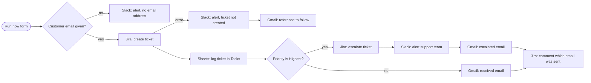

# FlowBridge product requirements

## The problem

Organisations run their daily work across disconnected applications: email, spreadsheets, CRM and project tools, payment platforms. People move information between them by hand, send the same notifications again and again, update records twice, and find out about failures late. The result is repetitive work, inconsistent data, slow follow-ups and processes nobody can see end to end.

FlowBridge connects those applications, runs each process automatically, and shows exactly what happened at every step, including what went wrong and how to put it right.

## Who uses it

| Role | What they do |
|------|--------------|
| Administrator | Manages members, the workspace, new apps and logos, and can do everything else |
| Workflow Builder | Builds, tests, publishes and looks after workflows. Manages integrations, investigates failures with full step data, retries runs and checks system health |
| Business User | Runs published workflows, follows their progress, retries failed runs and makes approval decisions |

The assignment suggested four possible roles and asked for research into how they interact. After comparing Workato, Make and n8n, Workflow Creator and Technical Operator were merged into Workflow Builder, and the team lead agreed to the change. The reasons are in decision 3.16.

The full permissions are in section 3 of [DECISIONS.md](DECISIONS.md) and in `apps/server/src/auth/permissions.ts`. Every API route checks them on the server.

Each role starts on an Overview made for it:

- **Administrators:** the workspace's health. Members, connected apps, run usage, workflows, the success rate, and a "Needs an Administrator" list (expiring connections, apps hitting limits, members who have not signed in).
- **Workflow Builders:** workflow figures, runs needing attention, the most used workflows, recent runs and system health.
- **Business Users:** decisions waiting for them, runs that did not finish explained in plain words, their automations as cards with a Run now button, and "What happened today" told as sentences.

## The automation lifecycle

| Stage | What happens |
|-------|--------------|
| Build | Drag steps onto a canvas, connect them, and fill each step's settings. Values from earlier steps are picked from real sample data. Start from scratch, a ready-made template or a template a colleague saved. |
| Test | Test one step, or the whole workflow with sample data. Tests really run, are marked as tests, and are left out of statistics and usage. |
| Publish | Saving keeps a private draft. Publishing creates a numbered version, and live runs always use the published version. |
| Run | A webhook, a schedule, a poll for new items, or a person pressing Run now and filling a short form. |
| Monitor | Every run is recorded step by step: the list of executions, a run page with each step's input, output and attempts, Analytics, Activity and notifications. |
| Recover | Failed steps retry automatically with growing waits. A failure can take its own path. A person can retry from the failed step, without repeating what already worked. |

## What it does

| Area | Capability |
|------|------------|
| Build | Visual canvas with undo and redo, a step panel with drag and drop, right-click menus, a live problems badge, a data picker, single-step testing, templates and team templates |
| Logic steps | HTTP request to any API, If / else, Delay, Approval with approved and rejected paths, Loop over a list |
| Data | References such as `{{trigger.body.email}}` and `{{steps.create_ticket.output.key}}`, ready-made dates such as `{{dates.tomorrow}}`, and schema validation of everything coming in |
| Start | Webhook with optional HMAC signature and repeat protection, schedule with time zone, polling for new items, Run now with a form the builder designs |
| Integrations | Slack, Gmail (plain or designed emails), Google Sheets, Stripe in test mode, and apps an Administrator describes, such as Jira |
| Reliability | Background worker, crash recovery, retries with growing waits, error paths, retry from the failed step, idempotency keys |
| Monitor | Executions with filters and CSV export, the step-by-step run page, Analytics with "Why runs failed", Activity history, system health |
| Notify | Per person, by email or in the app: a workflow you own fails, a daily failure summary, a credential about to expire, someone changes your workflow, a new member joins |
| Control | Three roles enforced on the server, encrypted credentials, monthly run limit, run history kept for a chosen period, default retries for new steps |

## Integrations

| Service | How it signs in | Actions |
|---------|-----------------|---------|
| Slack | Bot token | Send message |
| Gmail | Google sign-in (OAuth) | Send email, plain or in two designed styles; list messages; get a message |
| Google Sheets | Google sign-in (OAuth) | Append row, adding headings to an empty sheet; read rows |
| Stripe | Test secret key only | Create customer, create payment, list customers |
| Jira | Email and API token, added on the Integrations page | Create issue, update issue, add comment |
| Any web API | None, or a saved connection | HTTP request with any method |

Every integration was used in a real run against a real account. New services can be added either in code, as one file per service, or by an Administrator describing the service's web API on the Integrations page.

## Workflow 1: Welcome new customers

This follows the scenario in section 4 of the assignment, and is available as a template.

| Step | FlowBridge step |
|------|-----------------|
| 1. Receive the registration event | Webhook trigger |
| 2. Validate the submitted data | If / else: is there an email address? Missing data takes a separate path that alerts Slack |
| 3. Store the customer | Google Sheets, Append row to the Customers tab |
| 4. Send a confirmation email | Gmail, Send email, retrying up to 3 times |
| 5. Notify the sales team | Slack, Send message |
| 6. Create a follow-up task | Google Sheets, Append row to the Tasks tab |
| 7. Record execution history | Automatic for every run |

If the welcome email fails, the run page shows the step and the reason. Retry from failed step carries on from there, and the customer is not saved twice.

## Workflow 2: Support request to Jira

A published, working workflow built on the platform (Version 3). A customer's support request becomes a Jira ticket, is logged, is escalated if urgent, and the customer is kept informed. Business Users start it with Run now and a seven-question form: name, email, company, order number, priority, subject and what happened.

| Path | Steps that run | Proven |
|------|----------------|--------|
| Normal (Low, Medium, High) | Create ticket, log in Tasks, "Request received" email, comment on ticket | SCRUM-18, 13 November 2026 |
| Urgent (Highest) | Create ticket, log, escalate, Slack alert, "Urgent: escalated" email, comment | SCRUM-19, 13 November 2026 |
| Jira fails | Slack alert, "Reference to follow" email | Built and checked by design, not forced in a live run |
| No email address | Slack alert | Only reachable through the webhook, because the form requires an email |

The customer emails use the Branded header design: the company's name, a tagline, the key facts as large figures, the customer's own words quoted, and "Powered by FlowBridge" underneath. Ready-to-use test data is in [demo-data.md](demo-data.md).

## Assumptions and limitations

- **One workspace per installation:** the first person registers, and an Administrator adds everyone else.
- **New members' passwords:** there is no sign-up email, so new members receive a temporary password from their Administrator.
- **No database connector:** a spreadsheet stands in for a customer database. An HTTP step can call any database that has a web API.
- **No code steps, and no step for reshaping values:** references are looked up as paths, and there is no step for changing case, combining fields or arithmetic yet.
- **Retries:** a request a service rejects as wrong (a `4xx` reply) is retried like any other failure until attempts run out. Only a missing value is recognised as permanent.
- **Access is per role, not per workflow:** every Workflow Builder can edit every workflow, and every Business User can run every published workflow.
- **Loops** repeat one action, for up to 100 items.
- **Timing:** waits are checked every 20 seconds, so a delay can end up to 20 seconds late.
- **Google connections** expire after 7 days while the Google project is in Testing status. Reconnecting the same account refreshes them without breaking workflows.
- **Repeat protection:** Slack, Gmail and Sheets offer none, so a crash during those steps can repeat them. Stripe calls are protected.
- **The free host sleeps when idle:** overdue schedules and delays run when it wakes, and the first visit can take up to a minute.
- **Emails need a real address:** demo accounts use reserved `.example` addresses, so notification emails to them are not sent.
